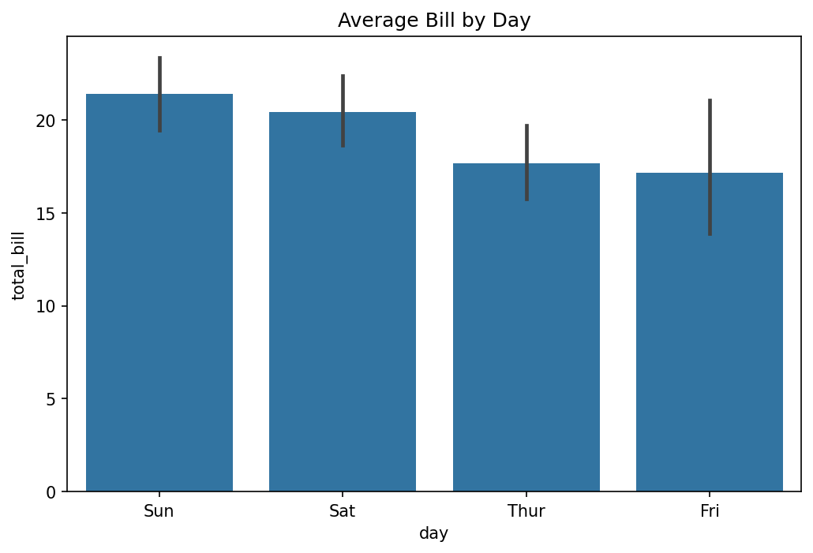
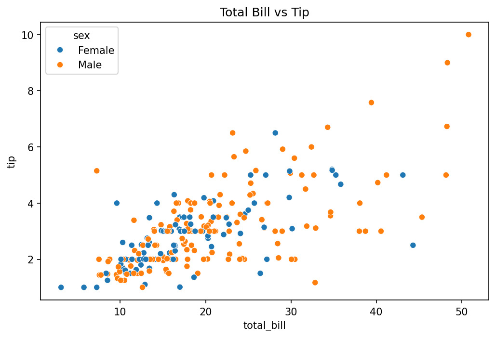
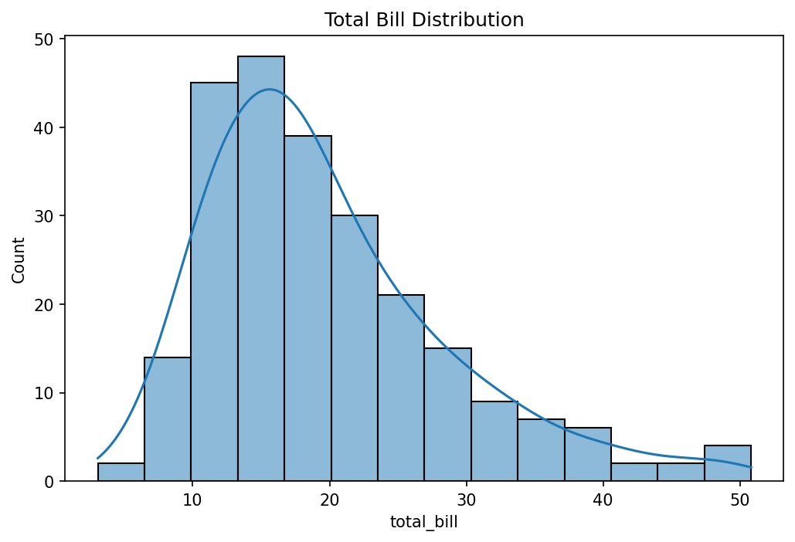
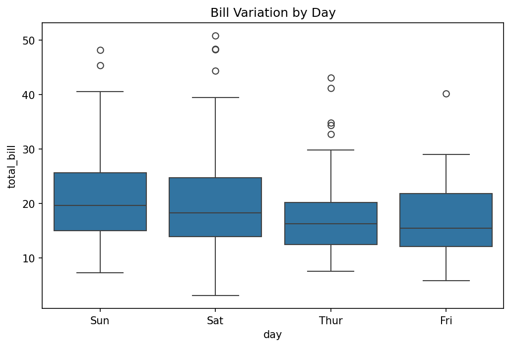

# CodeAlpha Internship – Task 3: Data Visualization

## Project Overview
This project visualizes the Tips dataset using Python.

## Dataset
Tips Dataset (`tips.csv`)

## Tools and Libraries
- Python
- Pandas
- Matplotlib
- Seaborn

## Visualizations Created
1. Bar Chart – Average Bill by Day
2. Scatter Plot – Total Bill vs Tip
3. Histogram – Total Bill Distribution
4. Box Plot – Bill Variation by Day

## Key Findings
- Sunday has the highest average bill.
- Tips generally increase as the total bill increases.
- Most bills are between 10 and 20.
- Saturday shows a wider variation in bills.

## How to Run
1. Install required libraries:
   `python -m pip install pandas matplotlib seaborn`
2. Run:
   `python visualization.py`

## Conclusion
The visualizations help understand bill patterns and relationships between total bills and tips.

## Graph Outputs

### 1. Average Bill by Day

### 2. Total Bill vs Tip

### 3. Total Bill Distribution

### 4. Bill Variation by Day

